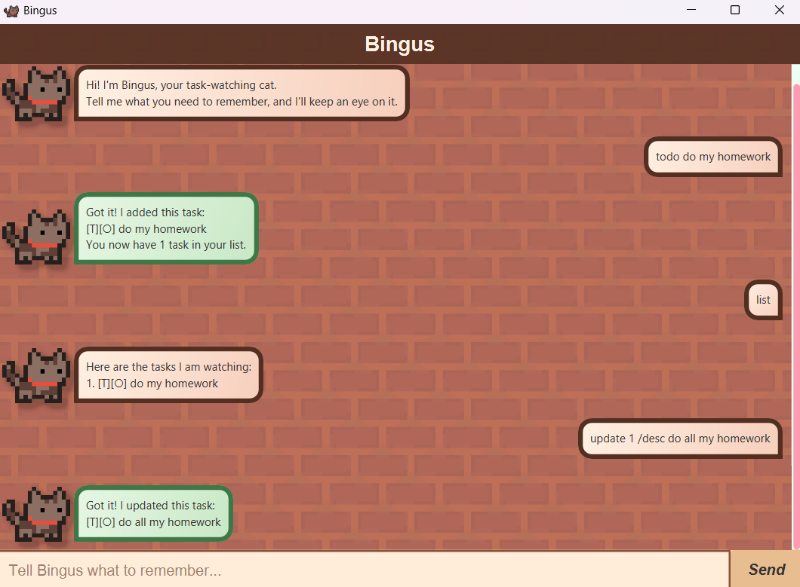

# Bingus User Guide

Bingus is a desktop task-management chatbot that helps you keep track of todos,
deadlines, and events through a simple command interface.

## Quick start

1. Launch Bingus.
2. Type a command in the input box at the bottom of the window.
3. Press Enter to run the command.
4. Try these commands:

   - `todo Review lecture notes`
   - `deadline Submit project proposal /by 2026-09-18 2359`
   - `event Team meeting /from 2026-09-15 1400 /to 2026-09-15 1530`
   - `list`

## Notes about command format

- Words in `UPPER_CASE` are values that you provide. For example, in
  `todo DESCRIPTION`, replace `DESCRIPTION` with a task such as `Buy groceries`.
- `TASK_NUMBER` refers to the positive number displayed for a task in the
  task list.
- Dates use the `yyyy-MM-dd` format and date-times use the
  `yyyy-MM-dd HHmm` format. For example, `2026-09-18 2359` represents
  18 September 2026 at 11:59 PM.

## Features

### Adding a todo: `todo`

Adds a task without a date or time.

Format: `todo DESCRIPTION`

Example:

- `todo Review lecture notes`

### Adding a deadline: `deadline`

Adds a task with a due date and time.

Format: `deadline DESCRIPTION /by yyyy-MM-dd HHmm`

Example:

- `deadline Submit project proposal /by 2026-09-18 2359`

### Adding an event: `event`

Adds an event with a start and end date-time. The end must be after the start.

Format: `event DESCRIPTION /from yyyy-MM-dd HHmm /to yyyy-MM-dd HHmm`

Example:

- `event Team meeting /from 2026-09-15 1400 /to 2026-09-15 1530`

### Listing tasks: `list`

Shows all tasks in the current task list.

Format: `list`

To show deadlines due on a date and events occurring on that date:

Format: `list yyyy-MM-dd`

Examples:

- `list`
- `list 2026-09-15`

### Finding tasks: `find`

Finds tasks whose descriptions contain the given keyword. Searches are
case-insensitive.

Format: `find KEYWORD`

Example:

- `find project`

### Marking a task as complete: `mark`

Marks the specified task as complete.

Format: `mark TASK_NUMBER`

Example:

- `mark 2`

### Marking a task as incomplete: `unmark`

Marks the specified task as incomplete.

Format: `unmark TASK_NUMBER`

Example:

- `unmark 2`

### Updating a task: `update`

Updates one detail of an existing task. The task retains its completion status.

Formats:

- `update TASK_NUMBER /desc DESCRIPTION`
- `update TASK_NUMBER /by yyyy-MM-dd HHmm` for a deadline
- `update TASK_NUMBER /from yyyy-MM-dd HHmm` for an event
- `update TASK_NUMBER /to yyyy-MM-dd HHmm` for an event

Examples:

- `update 1 /desc Review Week 6 lecture notes`
- `update 2 /by 2026-09-20 1800`
- `update 3 /to 2026-09-15 1600`

### Deleting a task: `delete`

Deletes the specified task from the task list.

Format: `delete TASK_NUMBER`

Example:

- `delete 3`

### Exiting Bingus: `bye`

Closes Bingus.

Format: `bye`

### Saving data

Bingus saves your tasks automatically after each change. You do not need to
save manually. Tasks are stored in `data/bingus.txt` relative to the folder
where Bingus is run.

## Command summary

Action | Format
--- | ---
Add a todo | `todo DESCRIPTION`
Add a deadline | `deadline DESCRIPTION /by yyyy-MM-dd HHmm`
Add an event | `event DESCRIPTION /from yyyy-MM-dd HHmm /to yyyy-MM-dd HHmm`
List all tasks | `list`
List tasks by date | `list yyyy-MM-dd`
Find tasks | `find KEYWORD`
Mark a task complete | `mark TASK_NUMBER`
Mark a task incomplete | `unmark TASK_NUMBER`
Update a task | `update TASK_NUMBER /desc DESCRIPTION`
Delete a task | `delete TASK_NUMBER`
Exit Bingus | `bye`
